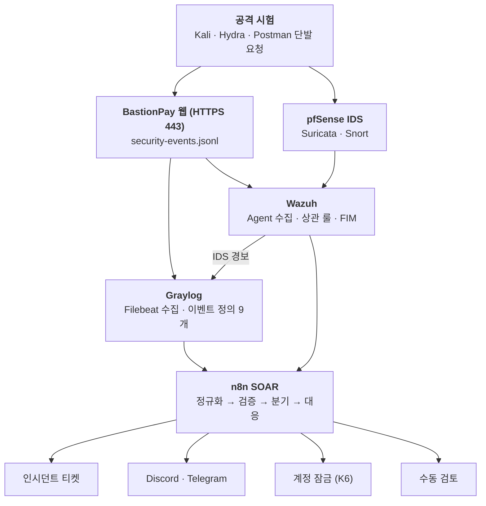
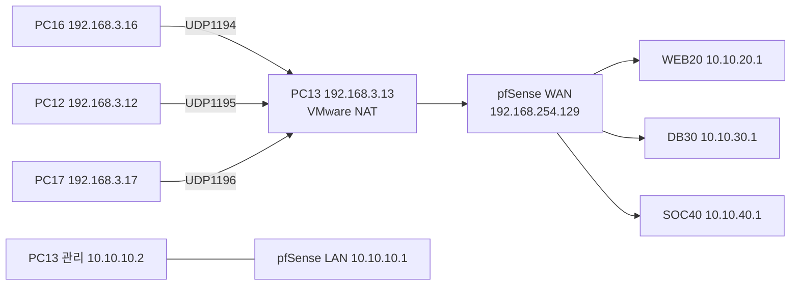

# BastionPay 프로젝트 작업 정리

> TEAM KAVANAH · 오픈뱅킹·가상계좌 서비스를 지키는 웹 방어 · 망 분리 · 관제 · 자동 대응 체계
> 정리일 2026-11-09

> 설치 안내: [처음부터 설치·실행하기](docs/SETUP.md)
>
> 팀 원본 저장소: [LeeHakSan/bastionpay](https://github.com/LeeHakSan/bastionpay)

이 저장소는 교육용 보안 실습 프로젝트입니다. 실제 금융 계정·실제 자금·운영용 인증정보를 사용하지 않으며, `.env`, 개발 인증서, 개인용 데이터는 저장소에 커밋하지 않습니다. SQL 시드의 계정·키 값은 로컬 테스트 전용 더미 값이므로 운영 환경에서 재사용하지 마십시오.

---

## 목차

1. [프로젝트 개요](#1-프로젝트-개요)
2. [팀 구성과 역할](#2-팀-구성과-역할)
3. [전체 아키텍처](#3-전체-아키텍처)
4. [사용 기술](#4-사용-기술)
5. [A · 웹 애플리케이션과 DB](#5-a--웹-애플리케이션과-db)
6. [B · pfSense 망 구성](#6-b--pfsense-망-구성)
7. [C · SIEM 관제 (Graylog·Wazuh)](#7-c--siem-관제-graylogwazuh)
8. [D · n8n SOAR와 탐지 규칙](#8-d--n8n-soar와-탐지-규칙)
9. [공격 시나리오와 검증 결과](#9-공격-시나리오와-검증-결과)
10. [남은 일과 확인하지 못한 것](#10-남은-일과-확인하지-못한-것)
11. [성과와 향후 방향](#11-성과와-향후-방향)
12. [발표 예상 질문(Q&A)](#12-발표-예상-질문qa)

---

## 1. 프로젝트 개요

BastionPay는 **가상 계좌와 가상 원장**으로 로그인, 계좌 연결, 모의 이체를 처리하는 금융 웹 서비스입니다. 실제 금융 계정과 실제 돈은 쓰지 않는 **보안 실습 서비스**입니다.

- 웹 앱과 함께 **모의 오픈뱅킹 은행 서버(MockBank)** 를 직접 구현
- 공격 시험부터 탐지, 티켓 생성까지 **한 흐름으로 검증**
- 핵심 키워드: 웹 보안 · VLAN/VPN · SIEM 탐지 · SOAR 자동화

| 지표 | 값 |
|---|---|
| 웹 화면 | 36개 |
| 보안 이벤트 종류 | 28종 (심각도 INFO ~ CRITICAL) |
| Graylog 탐지 정의 | 9개 (n8n용 K1~K6 포함) |
| 공격 시나리오 | 7종 |
| VLAN 구간 | 6개 (서비스 연결 3구간) |
| Java 파일 / 테스트 클래스 / DB 마이그레이션 | 121개 / 28개 / 11개 |

### 기획 배경

| 질문 | 내용 |
|---|---|
| 왜 만들었나 | 금융 서비스는 계정 탈취, 이체 위조, API 위조의 표적이다. 방어 기능이 있어도 공격을 알아채지 못하면 대응이 늦어진다 |
| 어떻게 풀었나 | ① 웹 자체의 방어 설정 ② VLAN·VPN으로 망 구간 분리 ③ 로그 수집과 탐지 규칙, 자동 티켓 |
| 무엇을 얻나 | 공격 한 번이 로그 → 경보 → 티켓으로 이어지는 흐름을 눈으로 확인하고, 단계마다 실측으로 검증 |

---

## 2. 팀 구성과 역할

| 구분 | 이름 | 직책 · 담당 | 주요 작업 | 산출물 |
|---|---|---|---|---|
| A | 이학산 | 부팀장 · WEB / DB | Java·Spring Boot 웹 앱, MySQL 운영, Postman 단발 검증 | API · 원장 증거 |
| B | 서효상 | 서기 · pfSense 망 | VMware의 pfSense 전용 VM, VLAN 권한 규칙, 관리망 게이트웨이(10.10.10.1), WAN 설정 | 주소 · 규칙 · pass/block 로그 |
| C | 심희현 | 팀장 · SIEM 관제 | Wazuh·Graylog 운영, A·D 앱 로그 연동, 승인된 Kali 테스트 | 원본 이벤트 · 검색 · 실험 기록 |
| D | 최재영 | 감사 · n8n SOAR | n8n 워크플로, Graylog Webhook 연결, 검증과 중복 억제, 티켓·알림·오류 처리 | execution ID · 처리 결과 |

**공동 검증 원칙**: VLAN 권한은 pfSense를 거치는 시험 client에서 검증하고, 실제 네트워크 경로를 증거로 삼았습니다.

---

## 3. 전체 아키텍처

### 3.1 수집에서 대응까지

같은 원본 로그를 Graylog와 Wazuh가 각각 수집하고, n8n에서 합류합니다.

### 3.2 망 구성 (PC 배치)

pfSense 한 대가 WAN, 관리망, 서비스 VLAN을 가운데서 통제합니다. 서비스 PC는 OpenVPN TAP 논리 링크로 각 VLAN에 연결되고, 관리 PC는 별도 관리망(10.10.10.0/24)에서만 접속합니다.

| PC | 학원망 주소 | VPN 주소 / 구간 | 올라가 있는 서비스 |
|---|---|---|---|
| PC13 | 192.168.3.13 | 관리 10.10.10.2 | pfSense VMware 호스트, VMnet8 NAT, 관리망 |
| PC16 | 192.168.3.16 | **10.10.20.16** / WEB20 | BastionPay 웹(Java TCP 443). SOC(Graylog·Wazuh)도 PC17에서 이쪽으로 옮겨옴 |
| PC12 | 192.168.3.12 | **10.10.30.12** / DB30 | 웹 MySQL 3306, MockBank MySQL 3307, 은행 API 8090, n8n 5678 |
| PC17 | 192.168.3.17 | 10.10.40.17 / SOC40 | Graylog·Wazuh Docker(이전 위치) |
| Kali | 미확인 | 10.10.60.10 / TEST60 | 외부 공격자 역할 |

*pfSense가 관리망과 WEB20·DB30·SOC40 구간을 가운데서 통제하는 구성*

> 학원 물리 스위치는 그대로 두고, TAP 이더넷 프레임을 OpenVPN으로 운반해 pfSense 안에서 802.1Q VLAN과 브리지했습니다. 서비스 PC에는 학원망 주소와 VPN 주소가 함께 있으므로 **VPN만으로 학원망 경로가 사라지지는 않습니다.**

---

## 4. 사용 기술

### 4.1 웹

| 구분 | 프레임워크 · 라이브러리 | 용도 |
|---|---|---|
| 기반 | Spring Boot 4.1.1, Java 21, Gradle | 웹 애플리케이션 틀과 빌드 |
| 웹 | Spring Web MVC, Thymeleaf | 서버 렌더링 화면 36개, 관리자 그래프 JSON, 관리자 API |
| 보안 | Spring Security, Nimbus JOSE | 로그인, 권한, CSRF, CSP 헤더, JWT 발급·검증 |
| 데이터 | Spring Data JPA, MySQL 8.0(Docker), Flyway | 회원·이체·이벤트 저장, 스키마 버전 관리(마이그레이션 11개) |
| 화면 | Chart.js 4.4.7, 바닐라 JS, CSS | 보안 대시보드 그래프. CSP 때문에 CDN 대신 `static/js/vendor`에 포함 |
| 보조 | Spring Mail, Validation, Lombok | 가입 인증 코드 메일, 입력값 검증 |
| 테스트 | Spring Boot Test, Spring Security Test | 테스트 클래스 28개 |
| 접속 보안 | PKCS12 개발 인증서 `config/local-dev.p12` | 개발용 HTTPS |
| 개발 환경 | IntelliJ IDEA, Git, Claude Code | 앱 실행, 팀 동기화, 코드 작성·검증 |

### 4.2 인프라 · 관제 · 자동화

| 구분 | 도구 | 용도 |
|---|---|---|
| 방화벽 · 망 | pfSense CE 2.7.2, VMware Workstation | 방화벽·라우팅, 802.1Q VLAN 6개, VMware NAT 기반 WAN |
| VPN | OpenVPN(TAP), 자체 CA | 서비스 PC를 VLAN에 연결하는 논리 링크 3개 |
| 로그 수집 | Filebeat, Wazuh Agent | 앱 JSONL 로그와 파일 변경 수집 |
| 탐지 · 관제 | Graylog, Wazuh Manager(Docker) | 이벤트 정의 9개, 상관 룰, 파일 무결성 감시(FIM) |
| 자동화 | n8n, Webhook, Discord, Telegram | 경보 정규화·분기, 티켓 생성, 알림 |
| 공격 시험 | Kali Linux, Hydra, Postman | 승인된 대상에 제한된 횟수로 시험 |

---

## 5. A · 웹 애플리케이션과 DB

### 5.1 개발 이력

| 날짜 | 커밋 | 내용 | 규모 |
|---|---|---|---|
| 10/19 | 940aa18 외 | 초기 설정, 메인·오류 페이지, 로그인·회원가입·대시보드 | 약 78개 파일 |
| 10/20 | 4105e6a 외 | MySQL docker-compose, HTTPS(SSL) 시도 | 설정 중심 |
| 10/21 | 3a7df77 | 오픈뱅킹 계좌 연결, 계좌 이체 | 143개 파일, +9,631줄 |
| 10/21 | e56d4a5 | 보안 대시보드, 로그아웃 타이머, 디자인 개편 | 123개 파일, +7,320줄 |
| 10/22 | 06a30ff | 테스트 계정용 SQL | 5개 파일, +470줄 |
| 10/23 | 7b57440 | 버그 수정 | 21개 파일, +723줄 |
| 10/29 | c34d475 | 보안 대시보드 그래프 | 14개 파일, +1,333줄 |

### 5.2 화면 구성

| 경로 | 화면 | 설명 |
|---|---|---|
| `/` | 소개 | 서비스 소개 메인 |
| `/signup` | 회원가입 | 이메일 → 인증 코드 → 비밀번호 → 프로필 → 완료 |
| `/login` | 로그인 | 로그인, 로그아웃 |
| `/dashboard` | 자산 대시보드 | 오픈뱅킹으로 연결한 실제 계좌 합계 |
| `/connect` | 은행 연결 | 오픈뱅킹 계좌 연결·해제 |
| `/accounts`, `/accounts/{번호}` | 계좌 목록·상세 | 연결 계좌와 잔액 |
| `/transactions` | 거래내역 | 계좌별 거래 조회 |
| `/transfer` | 이체 | 입력 → 확인 → 수정 → 실행 |
| `/admin/security` | 보안 대시보드 | 그래프 4종과 요약 |
| `/admin/security/graph/{종류}` | 그래프 상세 | 큰 그래프 + 필터링되는 이벤트 목록 |
| `/admin/security/events·audit·accounts·blocked-ips·tickets·stats` | 관리자 화면 | 이벤트, 감사 로그, 잠금 계정, 차단 IP, 티켓, 통계 |
| 401·403·404·4xx·5xx | 오류 화면 | 상태별 오류 페이지 |

> 예금·적금·가상계좌(`/deposits`, `/savings`, `/virtual-accounts`)는 하드코딩 예시 데이터라 11/04 이후 메뉴와 경로에서 제거했습니다(직접 입력 시 404). → [5.6](#56-1104-이후-웹-변경)

### 5.3 주요 기능

**회원 · 인증**
- 단계별 회원가입(인증 코드 6자리, 10분 유효, 재전송·중간 재시작 가능)
- JWT 쿠키 + refresh token 로그인, 비밀번호 BCrypt 해시
- 로그인 반복 실패 시 계정 잠금(관리자 해제 가능), 유휴 세션 만료, 세션 연장, 로그아웃 타이머

**오픈뱅킹 연결**
- 모의 은행과 OAuth로 계좌 연결·해제(휴대폰 본인 인증 → 권한 동의)
- 같은 은행 고객이 두 회원에 중복 연결되는 것을 DB 유니크 제약으로 차단
- 접속 주소(localhost, 팀 서버 IP)에 맞는 redirect URI를 허용 목록에서 선택

**이체 · 회원 등급**
- 입력 → 확인 → 실행 3단계. 중복 요청 방지, 실패·환불·사람 확인 필요 상태 구분
- 금액 입력 3자리 쉼표 서식(최대 15자)
- 누적 이체액으로 자동 승급, 3개월 미이용 시 한 단계씩 강등

| 등급 | 승급 기준(누적 이체) | 1회 이체 한도 |
|---|---|---|
| STANDARD | - | 200만원 |
| VIP | 1,000만원 | 1,000만원 |
| VVIP | 5,000만원 | 제한 없음 |

> 승급 기준 금액은 임의 기본값이며 `app.tier` 설정으로 변경합니다.

**보안 이벤트 기록**
- 인증, 접근 제어, 이체, 오픈뱅킹, 계정·권한, 보안 대응 사건 **28종** 기록
- 모든 요청에 trace ID를 부여해 응답 헤더 `X-Trace-Id`와 로그에 같은 값을 남김
- `logs/security-events.jsonl`(Graylog·Wazuh 수집용)과 DB에 함께 저장. 이메일은 해시만 기록

**관리자 보안 대시보드**

| 화면 | 내용 |
|---|---|
| 개요 | 이벤트 추이(심각도별 누적), 이체 결과 추이, 이벤트 종류 비율(도넛), 로그인 실패 상위 IP. 5분·1시간·1일 단위 |
| 그래프 상세 | 그래프 클릭 시 큰 그래프 + 이벤트 목록, 막대·조각 클릭 시 해당 조건으로 필터 |
| 이벤트 · 감사 | 보안 이벤트와 관리자 행위 감사 로그 조건별 조회 |
| 잠금 계정 | 잠긴 계정 확인·해제 |
| 차단 IP | 수동 차단·해제, n8n SOAR가 K6로 차단한 IP도 같은 목록에 기록. 관리자 본인 IP는 차단 불가 |
| 인시던트 티켓 | 출발지 IP별 최근 이벤트 자동 요약, IP별 열린 티켓은 하나만 유지, 일괄 종료 |
| 관리자 권한 | `ADMIN_ALLOWLIST` 밖 관리자 탐지·권한 회수. 마지막 관리자와 자기 자신은 회수·잠금 불가 |

### 5.4 웹 보안 대책 (공격별)

> 소스 코드와 설정을 직접 확인한 결과입니다. 실제 공격을 시도해 막히는지 본 시험은 아닙니다.

| 공격 · 위험 | 막은 방법 | 확인 수준 |
|---|---|---|
| XSS | Thymeleaf `th:text` 자동 이스케이프(`th:utext` 미사용), CSP로 script·style을 `'self'`만 허용, innerHTML·eval 미사용, `object-src 'none'`·`base-uri 'self'`·`form-action 'self'` | 코드·설정 확인 |
| SQL 인젝션 | JPA 사용, 직접 쓴 `@Query`·네이티브 쿼리도 이름 있는 파라미터 바인딩, LIKE escape, 그래프 종류는 정해진 값만 | 소스 검색 확인 |
| 입력값 변조 | Bean Validation(이메일 254자, 비밀번호 8~64자 조합, 이름 2~30자, 닉네임 2~12자 등) | 코드 확인 |
| CSRF | 쿠키 방식 CSRF 토큰, 거부 시 `CSRF_REJECTED` 기록. 키 인증 `/api/admin/**`만 예외 | 코드 확인 |
| 세션 · 토큰 탈취 | HttpOnly·SameSite·Secure 쿠키, JWT HS256 고정(alg=none 거부), refresh token 재사용 탐지 | IdleSessionTest |
| 무차별 대입 | 5회 실패 시 계정 잠금, 가입 인증 코드 시도 횟수 제한 | LockoutTest |
| 권한 우회 | `/admin/**`는 ADMIN만, 메서드 단위 `@PreAuthorize`. 403·401 이벤트 기록 | AccessControlTest |
| 서버 간 API 위조 | `X-API-Key` 시간 일정 비교, 키 미설정 시 전부 거부, 실패 시 `API_AUTH_FAILED`(키 값 미기록) | 시나리오 F 통과 |
| 차단 IP 접근 | 필터에서 403, `IP_BLOCKED_REQUEST` 기록 | 시나리오 L2 통과 |
| 오픈뱅킹 연결 위조 | state 값 시간 일정 비교, redirect URI 허용 목록, 토큰 암호화(TokenCipher) | 서비스 테스트 |
| 재전송 | 같은 이체 재요청은 `TRANSFER_REPLAY`로 거부 | 코드 확인 |
| 클릭재킹 · 정보 노출 | `X-Frame-Options DENY`, `frame-ancestors 'none'`, 오류 응답에 스택 트레이스 제외 | 설정 확인 |
| 로그 오염 · 민감정보 | 제어 문자 치환, 10자리 이상 숫자 마스킹, 이메일 해시, 계좌 뒤 6자리만 | 코드 확인 |

### 5.5 11/04까지의 웹 작업과 검증

| 작업 | 결과 |
|---|---|
| 중복 연결 차단 | DB 제약 + 화면 안내, 테스트 추가 |
| redirect URI 처리 | 접속 주소별 선택. `invalid_grant` 원인(브라우저가 다른 PC의 은행으로 이동) 진단 후 해결 |
| 개발용 HTTPS 인증서 | SAN에 localhost, 127.0.0.1, 팀 서버 IP 넣어 재발급 |
| 보안 대시보드 그래프 | Chart.js 4종 + 상세 페이지. 호버 끊김(빈 구간 툴팁 오류) 수정 → 60fps, 오류 0건 |
| 다른 PC에서 접속 | `.env`의 `SERVER_ADDRESS=0.0.0.0`으로 바인딩 변경 |

- 전체 테스트 스위트 BUILD SUCCESSFUL(SecurityChartsTest 8개, GraphDetailTest 9개 포함)
- 관리자 계정으로 그래프·상세 화면이 실제 DB 데이터로 표시되는 것 확인

### 5.6 11/04 이후 웹 변경

| 변경 | 내용 |
|---|---|
| DB 접속 주소 환경변수화 | `application-dev.yaml`·MockBank 설정의 DB 주소를 `${DB_HOST}`·`${MOCKBANK_DB_HOST}`로 변경. 실제 값(`10.10.30.12`)은 `.env`에만 둠 |
| HTTPS 443 | 기본 포트 8080 → 443, 오픈뱅킹 콜백 주소에서 `:8080` 제거 |
| 실행형 JAR 배포 | `bootJar`로 빌드해 `bastionpay-run` 폴더(JAR + `.env` + `config/local-dev.p12`)에서 실행 |
| 차단 IP 오류 화면 | 차단 필터가 CSS·JS까지 막아 403 화면이 깨지던 문제 수정(정적 파일 경로는 검사 제외) |
| 예금·적금·가상계좌 제거 | 하드코딩 예시 화면을 메뉴·경로에서 제거, 직접 입력 시 404 |

### 5.7 화면

**메인** · 서비스 소개와 가상계좌 예시

**이메일 인증** · 회원가입 시 6자리 코드, 10분 안에 입력

**계좌 연결 휴대폰 인증** · 모의 은행(MockBank)의 오픈뱅킹 OAuth 첫 단계

**이체** · 입력 → 확인 → 완료 3단계, 등급별 1회 한도

**관리자 보안 대시보드** · 최근 24시간 이벤트 추이, 이체 결과, 로그인 실패 상위 IP

**인시던트 티켓** · K6 ADMIN 권한 탈취 시도가 HIGH 티켓으로 생성된 화면

**IP 차단** · 수동 차단과 n8n SOAR 자동 차단 기록, 자기 차단 방지

**관리자 권한 · 계정 조치** · 허용 목록 밖 관리자 권한 회수(overpriv_test, admin1_test는 시험용 계정)

---

## 6. B · pfSense 망 구성

### 6.1 시스템

| 항목 | 값 |
|---|---|
| 제품 | pfSense CE 2.7.2-RELEASE (FreeBSD 14.0), VMware VM |
| 관리 URL | `https://10.10.10.1/` (관리 PC `10.10.10.2`만 허용, `ADMIN_HOSTS` 별칭) |
| SSH | 비활성 |
| DNS / NTP | unbound(DNSSEC 활성), ntpd |
| 추가 패키지 | 없음 |

### 6.2 인터페이스와 VLAN

| 이름 | 장치 | IPv4 | 비고 |
|---|---|---|---|
| WAN | em0 | DHCP → 192.168.254.129 | VMware DHCP에 MAC 예약 |
| LAN | em1 | 10.10.10.1/24 | 관리망 |
| WEB20 | em2.20 | 10.10.20.1/24 | 웹 |
| DB30 | em2.30 | 10.10.30.1/24 | DB · 은행 API |
| SOC40 | em2.40 | 10.10.40.1/24 | 관제 |
| SOAR50 | em2.50 | 10.10.50.1/24 | 자동화(미연결) |
| TEST60 | em2.60 | 10.10.60.1/24 | 시험(Kali) |
| MGMT10 | em2.10 | 없음 | VLAN 정의만 있음 |
| TAPWEB20 / TAPDB30 / TAPSOC40 | ovpns1~3 | 없음 | 각 VLAN과 브리지(bridge0~2, RSTP) |

### 6.3 OpenVPN TAP

| 서버 | 포트 | 브리지 구간 | 허용 CN | 고정 주소 |
|---|---|---|---|---|
| TAP_WEB20_PC16 | UDP 1194 | WEB20 | PC16-WEB20 | 10.10.20.16 |
| TAP_DB30_PC12 | UDP 1195 | DB30 | PC12-DB30 | 10.10.30.12 |
| TAP_SOC40_PC17 | UDP 1196 | SOC40 | PC17-SOC40 | 10.10.40.17 |

- 자체 CA(`BastionPay-VLAN-CA`)로 서버·클라이언트 인증서 발급, 서버당 최대 1대 접속
- AES-256-GCM(협상: AES-128-GCM, CHACHA20-POLY1305), 다이제스트 SHA256, TLS auth 키, 압축 거절
- 클라이언트 원격 주소는 PC13(`192.168.3.13`), 전체 트래픽 VPN 우회(redirect gateway) 없음

*PC16-WEB20 접속: 실제 주소 192.168.3.16 → 가상 주소 10.10.20.16, AES-256-GCM (DB30·SOC40 접속은 별도 작업 기록에서 확인)*

### 6.4 방화벽 규칙

**기본 규칙(22개 중 활성 19개)**

| 구간 | 허용 내용 |
|---|---|
| WAN | PC16→UDP1194, PC12→UDP1195, PC17→UDP1196 (출발지 PC별 제한) |
| LAN | `ADMIN_HOSTS`만 pfSense HTTPS 허용, 그 외 차단. 학원망 → PC16 TCP 443 |
| WEB20 · TAPWEB20 | `10.10.20.16 → 10.10.30.12` **TCP 3306, 3307, 8090만** |
| DB30 | 10.10.30.10 → pfSense DNS 53 |
| SOC40 · TAPSOC40 | PC17 → 게이트웨이 ping만 |

**SOC40 수집 규칙(11/04 15:22 추가, 8개)**: WEB20·DB30의 VLAN과 TAP 경로 각각에 TCP·UDP 규칙을 두어, 목적지 `10.10.40.17`의 수집 포트만 허용했습니다.

| 별칭 | 허용 포트 |
|---|---|
| `SOC40_INGEST_TCP` | TCP 1514-1515, 5044, 12201 |
| `SOC40_INGEST_UDP` | UDP 1514, 12201 |

- 모든 허용 규칙에 로그 기록. Filter Reload `Done`, 규칙 일치 로그 2건 확인
- 규칙 일치 로그는 정책 적용 근거일 뿐, SOC 쪽 최종 수신·처리를 증명하지는 않음

| 적용 전 (변경 대기) | 적용 후 (규칙 활성) |
|---|---|
|  |  |

**NAT**
- Port Forward(학원망 → WAN 443 → PC16) 1개: **비활성**
- Outbound NAT Hybrid: 학원망·관리 PC → PC16 TCP 443 응답 경로용 SNAT 2개 활성(웹 서버가 보는 출발지는 `10.10.20.1`로 바뀜)

### 6.5 PC13 VMware · Windows 설정

| 항목 | 내용 |
|---|---|
| VMnet8 NAT | 호스트 192.168.254.1, pfSense WAN 예약 192.168.254.129 |
| UDP 전달 | 1194←PC16, 1195←PC12, 1196←PC17 (출발지 제한, TCP 전달 없음) |
| Windows 방화벽 | UDP 1194/1195/1196 PC별 허용 규칙 활성, 학원망 HTTPS 443 규칙 비활성 |
| 라우팅 | `10.10.20.16/32 → 10.10.10.1` 영구 경로 |

### 6.6 PC16 Windows 웹 방화벽 (11/04 16:06)

pfSense가 아닌 **PC16 호스트 방화벽**에서 TCP 443의 출발지를 제한했습니다.

| 규칙 | 동작 | 원격 주소 |
|---|---|---|
| `BastionPay-PC16-Web443-Allow-v4` | 허용 | 192.168.3.0/24, 10.10.20.1, 10.10.10.2, 10.10.20.16, 127.0.0.0/8 |
| `BastionPay-PC16-Web443-Block-v4` | 차단 | 위를 제외한 IPv4 |
| `BastionPay-PC16-Web443-Block-Remote-v6` | 차단 | `::1` 제외 IPv6 |

확인: `192.168.3.13 → https://192.168.3.16/`, `10.10.10.2 → https://10.10.20.16/` 모두 HTTP 200.

### 6.7 망 구간 연결 검증

| 결과 | 시험 | 의미 |
|---|---|---|
| 성공 | PC16 → PC12 TCP 3306 | 웹 서버에서 DB로 VPN 구간 통과 |
| 도달 | 은행 API 8090 → HTTP 404 | API 프로세스까지 도달(루트 URL 미매핑) |
| 접속 | OpenVPN 클라이언트 | AES-256-GCM, 고정 주소로 접속 |
| 정상 | 계좌 연결과 조회 | VLAN 경유 환경에서 앱 기능 동작 |
| 응답 | Graylog 화면 | 학원망 경로 HTTP 200 |
| 성공 | SOC40 → Graylog 9000 | VPN 연결 당시 pfSense 발신 시험 |
| 차단→허용→원복 | Kali(10.10.60.10) → 10.10.30.50:8080 | 기본 차단 3건 → 임시 허용 HTTP 200 → 규칙 제거 후 다시 차단 |

**Kali–Ubuntu 통신 시험** (시험용 허용 규칙과 임시 경로는 시험 뒤 제거)

① 기본 차단: Default deny 로그 3건

② 임시 허용: HTTP 200 OK

③ 규칙 원복: 임시 규칙 제거 후 다시 Default deny(누적 6건)

---

## 7. C · SIEM 관제 (Graylog·Wazuh)

### 7.1 구성

| 도구 | 수집·탐지 방식 |
|---|---|
| Graylog | Filebeat가 JSONL을 읽어 Beats Input(TCP 5044)으로 전송, BastionPay 전용 스트림 분리, IP·계정·회원별 `count()`·`card()` 집계, 탐지 이벤트를 n8n Webhook으로 전달 |
| Wazuh | Agent로 앱 로그 수집·중앙 그룹 정책 배포, JSON 디코더로 이벤트 유형·IP·계정 해석, 기본 룰(단건) + 상관 룰(반복), 배포 폴더 FIM 감시 |

> 앱 로그는 Graylog에서 필드 이름에 `filebeat_` 접두사가 붙고, IDS 로그는 붙지 않습니다.

### 7.2 Wazuh 시나리오별 탐지 룰

| 시나리오 | 룰 번호 | 탐지 조건 |
|---|---|---|
| S1 반복 로그인 실패 | 100266 / 100268 | 같은 IP·같은 계정 비밀번호 오류 10분 내 5회 |
| L2 다중 계정 로그인 실패 | 100267 | 같은 IP·다른 계정, frequency 5 / 300초 |
| S3 반복 이체 실패·환불 | 100269 / 100270 | 같은 IP·심각도·사유 코드 환불 10분 내 2건 |
| 동일 계정 이체 요청 급증 | 100277 / 100278 | 같은 회원 ID 이체 요청 5분 내 5건 |
| 서버 API 인증 실패 | 100271 / 100272 | 같은 IP `API_AUTH_FAILED` 5분 내 3건 |
| 차단 IP 재요청 | 100273 / 100274 | 같은 IP `IP_BLOCKED_REQUEST` 5분 내 2건 |
| 파일 무결성(FIM) | 100282 | `bastionpay-run` 폴더 생성·수정·삭제(기본 FIM 룰 550·553·554 연계) |

---

## 8. D · n8n SOAR와 탐지 규칙

### 8.1 워크플로 "BastionPay - Security Alert Intake"

경보를 자동 처리하되, 애매한 경보는 버리지 않고 사람에게 넘기도록 설계했습니다.

| 단계 | 노드 | 내용 |
|---|---|---|
| 1. 수신 | Webhook(Graylog) `POST /bastionpay-graylog` Webhook(Wazuh) `POST /bastionpay-wazuh` | 소스별 별도 웹훅, 즉시 202 응답 후 뒤에서 처리(Wazuh는 헤더 인증) |
| 2. 정규화 | Edit Fields(Set) | `src_ip`, `title`, `event_type`, `severity`, `alert_source` 공통 필드로 변환 |
| 3. 검증 | Code + If | IP 형식과 알려진 이벤트 유형 확인. 정상 로그인·이체 완료는 폐기 |
| 4. 분기 | If | 아래 4갈래 |
| 5. 대응 | HTTP Request | `POST /api/admin/incident`(인증 헤더, SSL 검증 유지). 같은 IP 열린 티켓은 갱신 |

| 분기 | 조건 | 결과 |
|---|---|---|
| 티켓 생성 | 그 외 모든 공격 경보 | 인시던트 티켓 + Discord, CRITICAL이면 Telegram까지 |
| 운영자 알림 | 서버 API 인증 실패 반복 | Discord(운영자) |
| 수동 검토 | 모르는 유형, 잘못된 IP | Discord(검토) |
| 폐기 | 정상 로그인, 이체 완료 | 처리 안 함 |
| 권한 탈취 성공 | K6-B | 권한 회수 → 계정 잠금 |

*n8n 워크플로 전체: 웹훅 2개 → 정규화 → 검증 → 분기 → 티켓·Discord·Telegram·권한 회수·IP 차단*

### 8.2 Graylog 탐지 규칙 K1~K6

출발지 IP 기준으로 탐지하며, 모두 n8n Graylog 웹훅으로 보냅니다. 킬체인 기준으로 위험도를 재조정했습니다.

| 규칙 | 탐지 대상 | 공격 단계 | 등급 | 대응 |
|---|---|---|---|---|
| K1 | 웹 스캐너(Nikto·Gobuster) | 정보 수집 | LOW | LOW 티켓 |
| K5 | 네트워크 포트스캔(Snort) | 네트워크 정찰 | MEDIUM | MEDIUM 티켓 |
| K3 | Suricata IDS 경보 폭주(5건) | 취약점 페이로드 | MEDIUM | MEDIUM 티켓 |
| K2 | Hydra 로그인 브루트포스(1분 집중) | 계정 침투 시도 | MEDIUM | MEDIUM 티켓, 계정 잠금 시 HIGH 승격 |
| K4 | 저속·다계정 패스워드 스프레이 | 지능형 침투 시도 | MEDIUM | MEDIUM 티켓 |
| K6-A | ADMIN 권한 탈취 **시도** | 권한 상승 시도 | HIGH | HIGH 티켓, IP 차단 |
| K6-B | 무사유 ADMIN 승급 **성공** | 내부 장악 | CRITICAL | CRITICAL 티켓 + Telegram, 권한 회수·계정 잠금 |

### 8.3 n8n 보안 설정

| 항목 | 설정 |
|---|---|
| 내부 API 인증서 검증 | 웹 서버 인증서를 `NODE_EXTRA_CA_CERTS`로 신뢰 등록. Ignore SSL 없이 호출 |
| 포트 접근 제한 | 5678 포트를 SIEM PC(192.168.3.16)에서만 허용, 같은 대역 다른 PC는 차단 |

### 8.4 작업 기록

| 순서 | 분류 | 내용 |
|---|---|---|
| 1 | 구축 | Security Alert Intake 워크플로 최초 구성 |
| 2 | 환경 | 내부 HTTPS API 인증서 신뢰 등록(컨테이너 재생성, 데이터 볼륨 유지) |
| 3 | 분석 | 처리 경로·문제점 정리(필드 매핑, 웹훅 인증, 중복 억제 부재) |
| 4 | 테스트 | 위협 시나리오별 Postman 컬렉션(요청 38개), 로그인·잠금 시험 |
| 5 | 테스트 | 가짜 Graylog·Wazuh 경보로 분기별 동작 확인(n8n 단독) |
| 6 | 보안 | 5678 포트 SIEM PC만 허용, 웹훅 헤더 인증 |
| 7 | 설계 | K6 권한 탈취 탐지·자동 차단 흐름 |
| 8 | 진단 | 웹 서버 인증서 SAN에 접속 IP가 없는 문제를 n8n 컨테이너에서 확인 |
| 9 | 수정 | ADMIN 권한 회수 노드를 시나리오 범위에서 제외 |
| 10 | 테스트 | Graylog 신규 이벤트(스캐너·Hydra·Suricata 폭주·저속 브루트포스·포트스캔) |
| 11 | 보안 | 넓게 열린 방화벽 규칙을 접속 시험으로 발견해 SIEM PC만 허용 |
| 12 | 보안 | SIEM 서버 이전에 맞춰 방화벽 출발지 수정 |
| 13 | 최적화 | 킬체인 기반 위험도 재조정(K2·K4·K5 MEDIUM), K6 시도(HIGH)/성공(CRITICAL) 분리 |

---

## 9. 공격 시나리오와 검증 결과

### 9.1 시나리오 정의

| # | 시나리오 | 탐지 기준 | 대응 |
|---|---|---|---|
| 1 | 반복 로그인 실패 | 같은 IP·같은 계정 10분 내 5회 | 계정 잠금, Wazuh·Graylog 경보, 티켓 |
| 2 | 다중 계정 시도 | 같은 IP에서 5분 내 서로 다른 계정 5개 이상 | 검토 티켓 |
| 3 | 이체 실패 후 환불 반복 | 같은 출발지 10분 내 2건 이상 | 티켓 생성 |
| 4 | 서버 API 인증 실패 | 같은 IP 5분 내 3회 | 운영자 알림 |
| 5 | 차단 IP 재요청 | 차단 목록 IP가 5분 내 2회 요청 | 403 거부, 티켓 갱신 |
| 6 | 스캐너·포트스캔·IDS 폭주 | Nikto, Gobuster, Snort, Suricata 경보 | 등급별 티켓(LOW~MEDIUM) |
| 7 | 권한 탈취 시도와 성공 | 무사유 등급 승급, ADMIN 무단 접근 | HIGH·CRITICAL 티켓, Telegram |

### 9.2 시연 검증표

| 시나리오 | 확인한 것 | 시연 | 결과 |
|---|---|---|---|
| S1 반복 로그인 실패 | 5회 입력, 앱 잠금, Wazuh·Graylog 경보 | 서효상 | 통과 |
| L2 다중 계정 실패 | 같은 IP의 서로 다른 계정 실패 집계(card) | 심희현 | 통과 |
| S3 동일 출발지 반복 이체 | 이체 실패·환불 2건 이상 집계 | 심희현 | 통과 |
| K6 권한 탈취 시도 | ADMIN 권한 탈취 시도 탐지 | 최재영 | 통과 |
| K6 비정상 권한 승급 침해 | ADMIN 승급 침해, SOAR 대응 | 최재영 | 통과 |
| 동일 계정 이체 요청 급증 | 같은 회원 이체 5건 요청 급증 경보 | 이학산 | 통과 |
| 서버 API 인증 실패 | 틀린 API 키로 관리자 API 반복 호출 탐지 | 이학산 | 대조 수행 |

### 9.3 시연 영상

실제 시연 녹화를 배속(4~6배)으로 줄인 GIF입니다.

**동일 계정 이체 요청 급증** · 같은 회원 ID로 5분 안에 이체 요청 5건을 보내 Wazuh 룰 100277/100278 경보와 n8n 티켓 생성까지 확인 (4배속)

**동일 계정 이체 요청 급증에 이어 서버 API 인증 실패** · 틀린 `X-API-Key`로 서버 API를 반복 호출해 `API_AUTH_FAILED` 3회 탐지와 운영자 알림 분기 확인 (4배속)

**ADMIN 권한 탈취 시도와 탈취 성공 (K6-A · K6-B)** · ADMIN 무단 접근 시도는 HIGH 티켓, 무사유 ADMIN 승급 성공은 CRITICAL 티켓과 Telegram 알림, 계정 잠금까지 확인 (6배속)

### 9.4 검증 방법

작은 단위부터 전체 구간 순서로 쌓았습니다. 모든 시험은 **단발성**이며 부하 시험은 하지 않았습니다.

| 단계 | 방법 | 확인하는 것 |
|---|---|---|
| 1. n8n 단독 | Postman으로 가짜 경보 14종을 웹훅에 직접 전송 | 분기 동작, 인증 없는 요청 거부 |
| 2. 앱 단발 요청 | 미인증 접근, 로그인 실패·잠금, 권한 우회, 잘못된·중복 이체 | 앱의 거부와 보안 이벤트 기록 |
| 3. Graylog 경유 | 시험 로그 주입 | K1~K6 경보 생성과 n8n 전달 |
| 4. 실제 공격 트래픽 | Kali에서 승인된 대상에 제한된 횟수 | 탐지부터 티켓·알림까지 전체 구간 |

- 시험별 계정 분리(K2·K4·K6용)로 앞 시험의 잠금이 다음 결과를 오염시키지 않게 함
- 시험 전후 잠금 해제와 티켓 종료로 상태 초기화
- n8n execution ID와 웹 티켓 ID를 대조해 처리 성공 확인

---

## 10. 남은 일과 확인하지 못한 것

### 웹

| 항목 | 상태 |
|---|---|
| 인증서 경고 | 자체 서명이라 접속 PC마다 경고. mkcert 신뢰 등록 또는 도메인 인증서 필요 |
| 등급 승급 기준 | 임의 기본값, 확정 필요 |
| 공격 시험 | XSS·SQL 인젝션 직접 시험 안 함. ZAP 등으로 점검 권장 |
| 그래프 → 목록 자동 스크롤 | 논의만 하고 미적용 |
| MockBank redirect URI | 443 콜백 주소를 MockBank DB에 등록해야 계좌 연결 가능 |

### 망 · 관제

| 항목 | 상태 |
|---|---|
| SOC 이전 | Graylog·Wazuh가 PC17 → PC16으로 이전. SOC40 수집 규칙의 목적지는 아직 `10.10.40.17`이라 종단 연동 미완료 |
| MockBank DB 3307 | MySQL이 `127.0.0.1:3307`로 묶여 있어 VPN 구간에서 접속 안 됨 |
| PC17 VPN | 11/04 12:23 기준 0대. 지속 연결·재부팅 후 자동 연결 미검증 |
| Wazuh 443 | SOC40 → 10.10.40.17:443 실패, 원인 미조사 |
| pfSense 로그 → Graylog | 원격 syslog 미설정 |
| SOAR50 | n8n은 PC12에 DB와 함께 있고 SOAR50 VLAN에 연결 안 됨 |
| TEST60 → WEB20 | 허용·시험 미완료. 시험용 WEB20→10.10.30.10:3306 규칙이 아직 활성 |
| LAN 기본 허용 | 관리 LAN의 allow-any 규칙이 남아 최소 권한 아님 |
| 학원망 우회 | 학원망 직접 접근은 pfSense를 거치지 않음. SOC40 전용 격리 미완료 |
| PC16 443 차단 시험 | 비허용 출발지에서 실제 차단되는지 미시험 |
| pfSense crash 배너 | 원인 미확인 |
| n8n 인증서 | 웹 서버 이전 후 SAN 재확인 필요 |

---

## 11. 성과와 향후 방향

**성과**
- 웹, 망, 관제, 자동 대응이 이어지는 전체 흐름을 직접 구축
- 같은 로그를 두 도구로 따로 수집해 탐지 근거를 교차 확인
- 공격 시나리오 7종에 등급과 대응 규칙을 설계

**향후 방향**
- 로그 전송 구간에 TLS 적용
- pfSense 방화벽 로그를 관제에 통합
- ZAP 등으로 웹 취약점 점검 범위 확대
- 탐지 결과에 따른 자동 차단 대응 확장

---

## 12. 발표 예상 질문(Q&A)

**Q. ADMIN 권한 탈취를 두 개 시연했는데 차이가 뭔가요?**
첫 번째는 시도에서 그친 경우(K6-A)이고 두 번째는 탈취에 성공한 경우(K6-B)입니다. 시도는 IP 차단만 하고, 성공하면 즉시 권한을 회수하고 계정을 잠급니다.

**Q. Filebeat를 왜 사용했나요?**
웹앱이 파일로 남기는 보안 로그를 Graylog에 자동으로 보내기 위해서입니다. 웹앱과 로그 전송을 분리할 수 있고, Filebeat가 읽은 위치를 관리하며 새 기록을 계속 수집합니다.

**Q. pfSense 수집 규칙을 왜 8개 만들었나요?**
WEB20과 DB30 각각에 VLAN 경로와 OpenVPN TAP 경로가 있고, 경로마다 TCP·UDP 규칙을 두었기 때문입니다(2구간 × 2경로 × 2프로토콜).

**Q. 5회 실패 잠금이 오히려 공격에 악용되지 않나요?**
관리자 화면에서 바로 잠금을 풀 수 있게 했고, 같은 IP의 반복 실패는 Graylog와 Wazuh가 경보로 잡습니다.

**Q. 금융 서비스인데 왜 Oracle이 아니라 MySQL을 썼나요?**
Oracle이 트랜잭션 처리가 강력하고 금융권에서 많이 쓰이는 것은 맞습니다. 하지만 상용 라이선스 비용이 들어서 교육용 실습 프로젝트에는 맞지 않았습니다. 대신 트랜잭션 무결성은 DB 제품에 맡기지 않고 백엔드에서 직접 처리했습니다.
- 이체 한 건을 하나의 DB 트랜잭션(Spring `@Transactional`)으로 묶어, 중간에 실패하면 잔액과 거래내역이 함께 되돌아갑니다.
- 이체에 쓰는 계좌에 행 잠금(`SELECT ... FOR UPDATE`)을 항상 같은 순서(계좌 id 순)로 걸어, 동시에 출금해도 잔액이 음수가 되거나 이중 출금되지 않고 교착 상태도 생기지 않습니다.
- 검증은 잔액을 바꾸기 전에 모두 끝내고, 금액 한도와 잔액은 요청 값을 믿지 않고 서버가 판단합니다.
- 같은 거래고유번호·요청 ID는 한 번만 처리하도록 DB 유니크 제약으로 막아, 재전송·중복 요청이 두 번 반영되지 않습니다.

MySQL(InnoDB)도 ACID 트랜잭션과 행 잠금을 지원하기 때문에, 이 구조로 실습 범위의 정합성은 충분히 지킬 수 있었습니다.
